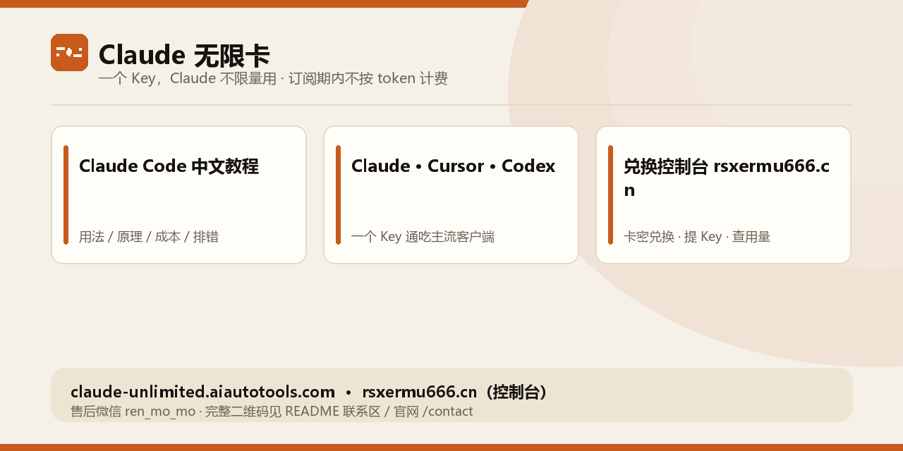

# Claude 无限卡 · 一个 Key，Claude Code 不限量用

> 订阅期内 Claude API **不按 token 计费**：一个 Key，Claude Code / Cursor / Cline / Codex 等主流客户端直接接入。

[](https://claude-unlimited.aiautotools.com)
[](LICENSE)
[](https://claude-unlimited.aiautotools.com/guide/cc)
[](https://claude-unlimited.aiautotools.com/knowledge)

**[官网 →](https://claude-unlimited.aiautotools.com)** ｜ [套餐定价 →](https://claude-unlimited.aiautotools.com/pricing) ｜ [使用教程 →](https://claude-unlimited.aiautotools.com/guide) ｜ [知识库 →](https://claude-unlimited.aiautotools.com/knowledge) ｜ [兑换 Key →](https://claude-unlimited.aiautotools.com/console)



## 这是什么

Claude 无限卡是独立运营的第三方 API 网关：把 Claude 模型调用按订阅期打包售卖。订阅期内不按 token 计费，按固定订阅价收费。

接入只改两处——Base URL 与 API Key。不必重写业务逻辑，不必换 SDK；能接 Anthropic 或 OpenAI 兼容接口的客户端都能用。

## 适合谁

- **每天在 Claude Code / Cursor 里写代码的人**。按 token 买的话，长上下文会话成本不可控；订阅制下你只关心「这个月要不要续」。
- **想用 Opus 又不想按量付费的人**。同一订阅价内可选更高档模型，不因选 Opus 产生额外费用。
- **需要在多个客户端之间切换的人**。Claude Code、Claude 桌面版、Codex、Cursor 等各有一条带截图的完整路径，配一次全局生效。

不适合：想按次付、每次调用量都很小的人；需要企业级 SLA 合同与发票的用户；以及要求每一条请求都能直连 Anthropic 官方、不经任何中间层的场景。

## 三步接入

1. **下单拿卡密**。发卡站支付后自动发货，拿到一串卡密。
2. **兑换成 Key**。在[卡密兑换与 API Key](https://claude-unlimited.aiautotools.com/console)页面粘贴卡密，页面给出 Base URL 与 `sk-` 开头的 API Key。
3. **填进客户端**。装 [CC Switch](https://claude-unlimited.aiautotools.com/guide/cc) 一键导入，或写入环境变量：

```bash
export ANTHROPIC_BASE_URL="https://<兑换页给出的 Base URL>"
export ANTHROPIC_API_KEY="sk-..."
```

不装工具、只设这两个变量，Claude Code CLI 同样能用。按客户端选完整路径见下方教程。

## 使用教程：按你用的客户端选一条路

<!-- readme:guide:start -->

按你用的客户端选一条路，每条路都有完整步骤与真实截图。共 6 条路径。

| 客户端 | 这条路讲什么 | 规模 |
|---|---|---|
| [Claude Code 插件](https://claude-unlimited.aiautotools.com/guide/cc) | 同一款 Anthropic 官方插件，VS Code 和 Cursor 都能装。图形界面用，比命令行更好上手。 | 10 步 · 一键导入 |
| [Claude Code CLI](https://claude-unlimited.aiautotools.com/guide/cli) | 终端里的 Claude Code。官方脚本装 CLI，两个环境变量接上网关，装完就能直接用。 | 9 步 · 装 CLI + 变量 |
| [Claude 桌面版](https://claude-unlimited.aiautotools.com/guide/desktop) | 桌面版要单独建一个供应商并开路由，比 Claude Code 多两步。装完桌面版客户端即可用，也不用翻墙。 | 13 步 · 新增供应商 |
| [Codex](https://claude-unlimited.aiautotools.com/guide/codex) | Codex 多两个关键动作：上游格式必须选 Anthropic Messages，配置完必须彻底重启 Codex 才会生效。 | 11 步 · 新增供应商 |
| [WorkBuddy](https://claude-unlimited.aiautotools.com/guide/workbuddy) | 最省事的一条路，不用装 CC Switch，也不用开路由。三个值填进 WorkBuddy 的自定义模型里就行。 | 3 步 · 自定义模型 |
| [其它客户端](https://claude-unlimited.aiautotools.com/guide/cursor) | 已经会自己填 API 的人看这一页：三个值怎么填、各客户端的差异，一次说清。 | 三个值 · 两张速查表 · 手动填值 |

全部路径：[使用教程索引](https://claude-unlimited.aiautotools.com/guide)

<!-- readme:guide:end -->

## Claude 知识库

<!-- readme:knowledge:start -->

精选 6 篇（完整 25 篇见[Claude 知识库](https://claude-unlimited.aiautotools.com/knowledge)）。官网与仓库是同一份正文。

| 文章 | 一句话 | 仓库源码 |
|---|---|---|
| [Claude Code 教程：第一次会话之后怎么用](https://claude-unlimited.aiautotools.com/knowledge/claude-code-tutorial) | 配置完成后怎么把 Claude Code 用顺手：CLAUDE.md、工作流、常用命令。 | [`site/docs/knowledge/claude-code-tutorial.md`](site/docs/knowledge/claude-code-tutorial.md) |
| [Claude Code 计划模式怎么用：四种权限模式的区别](https://claude-unlimited.aiautotools.com/knowledge/claude-code-plan-mode) | plan / manual / acceptEdits / auto 的差别，何时先要计划再动手。 | [`site/docs/knowledge/claude-code-plan-mode.md`](site/docs/knowledge/claude-code-plan-mode.md) |
| [CLAUDE.md 怎么写：写什么、放哪](https://claude-unlimited.aiautotools.com/knowledge/claude-md-guide) | CLAUDE.md 写什么放哪，AGENTS.md 何时被读，.claude 目录各文件用途。 | [`site/docs/knowledge/claude-md-guide.md`](site/docs/knowledge/claude-md-guide.md) |
| [Claude API 怎么计费：token 构成与估算](https://claude-unlimited.aiautotools.com/knowledge/claude-api-pricing-explained) | 输入与输出 token 的构成、缓存价，以及一个可复用的估算公式。 | [`site/docs/knowledge/claude-api-pricing-explained.md`](site/docs/knowledge/claude-api-pricing-explained.md) |
| [prompt too long 报错怎么处理](https://claude-unlimited.aiautotools.com/knowledge/claude-code-prompt-too-long-fix) | 先 /context 看构成，再按固定成本、单次输出、正常增长三种情况分别处理。 | [`site/docs/knowledge/claude-code-prompt-too-long-fix.md`](site/docs/knowledge/claude-code-prompt-too-long-fix.md) |
| [Claude Code 报 429 限流怎么办](https://claude-unlimited.aiautotools.com/knowledge/claude-code-429-rate-limit) | 429 的三个上限、Agent 更容易撞上的原因、六步处理顺序。 | [`site/docs/knowledge/claude-code-429-rate-limit.md`](site/docs/knowledge/claude-code-429-rate-limit.md) |

<!-- readme:knowledge:end -->

## 套餐与价格

适合长会话、Agent、反复改代码的场景；和官方按量比，是否划算取决于你的用量。

<!-- readme:plans:start -->

价格与发卡站在售商品同步，官网[套餐定价](https://claude-unlimited.aiautotools.com/pricing)页是最终准价来源。

| 档位 | 有效期 | 价格 | 备注 | 购买 |
|---|---|---|---|---|
| 无限卡 · 天卡 | 1 天 | ¥16.5 <s>¥25</s> |  | [购买](https://catfk.com/item/vfzavb) |
| 无限卡 · 周卡 | 7 天 | ¥80 |  | [购买](https://catfk.com/item/1ga80a) |
| 无限卡 · 月卡 | 30 天 | ¥145 | 最多人选 | [购买](https://catfk.com/item/b8zhn8) |
| 无限卡 · 双窗口月卡 | 30 天 | ¥185 | 双会话 | [购买](https://catfk.com/item/mrj7f7) |
| 无限卡 · 三窗口月卡 | 30 天 | ¥225 | 三会话 | [购买](https://catfk.com/item/igxkqf) |

<!-- readme:plans:end -->

## 常见问题

<!-- readme:faq:start -->

买家最常问的几个，完整 FAQ 见[官网常见问题](https://claude-unlimited.aiautotools.com/faq)。

**你们是 Anthropic 官方吗？**

不是：本站是独立的第三方 API 网关服务，仅通过兼容接口转发起调用。

**「无限额度」到底无限到什么程度？**

订阅期内不按 token 计费：你发起的每次调用，无论消耗 1 千还是 20 万 token，都包含在订阅价里。

**支持哪些模型？新模型上线要换 Key 吗？**

本卡承诺 Fable 5.1 与 Opus 5.5 两个模型，均在同一订阅价内，不因选择 Opus 产生额外费用。

**支持哪些客户端和工具？**

凡是能接 Anthropic 或 OpenAI 兼容接口的都能用，包括：Claude Code、Cursor、Cline、Roo Code、Aider、Continue、Zed、JetBrains、VS Code，以及官方 Python / TypeScript / Go SDK。

**限速和并发的具体数字是多少？**

为保证所有用户稳定访问，网关设有公平使用速率限制，具体数值会随上游容量调整：

- 会话窗口：基础档同时 1 个会话；双窗口 / 三窗口档以对应套餐为准；
- 单会话并发：默认 20 路；
- 请求速率：默认 60 次/分钟；
- Token 吞吐：默认 300k token/分钟。

**被限制了怎么申诉？**

先看返回的错误类型：429 是速率限制，等待 Retry-After 后自动恢复，不需要申诉。

**我的请求内容会被存储吗？**

我们以提供服务与排查故障所必需的限度记录用量元数据（调用时间、模型、状态、消耗、请求标识），不记录你的 prompt 正文与模型输出。

**稳定性有保障吗？**

网关通过多上游账号智能路由与自动故障转移来提升可用性，目标可用率 99.9%。但服务依赖上游模型供应商与公网，我们不对不中断作绝对保证。

<!-- readme:faq:end -->

## 信任与合规

- 本站与 Anthropic 官方没有隶属、授权或合作关系；Claude、Anthropic 等名称与商标归其各自所有者。
- 网关与计费不开源。本仓库公开的是官方文档、接入教程、知识库正文，以及官网前端，便于核对站上数字与文案。
- MIT 许可只覆盖代码，不覆盖「Claude 无限卡」这一品牌、服务与任何商标。
- 包含与不包含、公平使用与退款规则，以[官网定价页](https://claude-unlimited.aiautotools.com/pricing)与购买页商品详情为准。
- 购买、兑换与售后一律以[官网](https://claude-unlimited.aiautotools.com)与管理后台为准；本仓库的 issue 与 discussion 只用于文档与源码问题。

## 社区与联系

- **买之前有问题**：右下角在线助手，或[官网](https://claude-unlimited.aiautotools.com)的客服入口。issue 与 discussion 不是客服渠道。
- **文档或源码有 bug**：提 [issue](https://github.com/autotoolai/claude-unlimited/issues)。
- **用法讨论**：提 [discussion](https://github.com/autotoolai/claude-unlimited/discussions)。
- **站内变更历史**：[changelog](https://claude-unlimited.aiautotools.com/changelog)。

## 给贡献者

想改教程、知识库、FAQ 或站点前端时看这里。日常使用者直接走上方接入与教程即可。

仓库结构：

```
claude-unlimited/
├─ site/                     文档站与官网前端（VitePress）
│  ├─ config/                数据源：商品、模型、FAQ、教程、知识库元数据
│  ├─ docs/                  内容根：路由壳 + knowledge/ 正文
│  ├─ .vitepress/theme/      组件与样式
│  ├─ scripts/               构建、sitemap、llms、OG、门禁
│  └─ public/                静态资源
├─ .github/                  Issue / PR 模板、CI
└─ docs/                     仓库级文档索引
```

### 本地开发

需要 Node 20 与 Python 3.12（构建链里有 Python 门禁）。

```bash
git clone https://github.com/autotoolai/claude-unlimited.git
cd claude-unlimited/site
npm ci
npm run dev:site   # 站点 dev server，端口 41800
```

改完必须跑完构建门禁与验收，任意一道红就别发布：

```bash
npm run build        # 构建链：结构门禁、SEO 与地理门禁、死链、CSS 检查
npm run verify       # 逐页验收断言
npm run check:links
npm run check:css    # 改了 .vitepress/theme/**/*.css 必跑
```

细节看 [`site/README.md`](site/README.md)、[`site/docs/README.md`](site/docs/README.md) 与 [`docs/`](docs/README.md)。

### 文档与贡献

- **只改内容**（知识库文章、FAQ、套餐文案）：先读 [`site/content/knowledge/guide.md`](site/content/knowledge/guide.md)；草稿写在 `site/content/knowledge/drafts/`。
- **改源码**：先读 [`site/CLAUDE.md`](site/CLAUDE.md)。
- 完整流程见 [CONTRIBUTING.md](CONTRIBUTING.md)。
- 行为准则见 [CODE_OF_CONDUCT.md](CODE_OF_CONDUCT.md)，安全问题报告见 [SECURITY.md](SECURITY.md)。

## License

[MIT](LICENSE)。代码可自由取用；品牌、服务与商标不在授权范围内。
