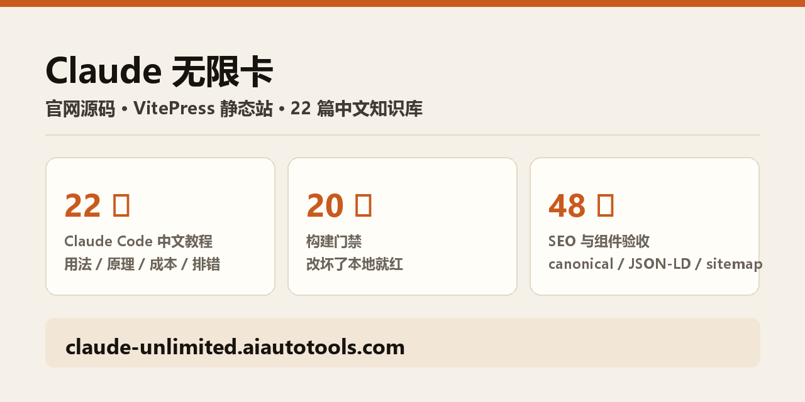

# Claude 无限卡 · 一个 Key，Claude Code 不限量用

> 订阅期内 Claude API **不按 token 计费**：一个 Key，Claude Code / Cursor / Cline / Codex 等主流客户端直接接入。

[](https://claude-unlimited.aiautotools.com)
[](LICENSE)
[](https://claude-unlimited.aiautotools.com/guide/cc)
[](https://claude-unlimited.aiautotools.com/knowledge)

**[官网首页 →](https://claude-unlimited.aiautotools.com)** ｜ [套餐定价 →](https://claude-unlimited.aiautotools.com/pricing) ｜ [使用教程 →](https://claude-unlimited.aiautotools.com/guide) ｜ [知识库 →](https://claude-unlimited.aiautotools.com/knowledge)



## 这是什么

Claude 无限卡是一个独立运营的第三方 API 网关服务，把 Claude 模型的调用按订阅期打包售卖：订阅期内调用不按 token 计费，按固定订阅价收费。

接入方式只有一个：改一个 Base URL 加一个 Key。不要求你重写业务逻辑，不要求放弃现有 SDK，凡是能接 Anthropic 或 OpenAI 兼容接口的客户端都能用。

本仓库是这个服务的**官网前端源码**，同时也是站内全部内容的可核对版本：站上写的每一个数字、每一篇文章、每一条价格，都能在仓库里逐条找到出处。

## 适合谁

- **每天在 Claude Code / Cursor 里写代码的人**。按 token 买的话，长上下文的会话成本不可控；订阅制下你只关心「这个月要不要续」。
- **想用 Opus 又不想按量付费的人**。同一订阅价内可选更高档的模型，不因选 Opus 产生额外费用。
- **需要在多个客户端之间切换的人**。Claude Code、Claude 桌面版、Codex、Cursor 等各有一条带截图的完整路径，配一次全局生效。

不适合：想按次付、每次调用量都很小的人；需要企业级 SLA 合同与发票的用户；以及要求每一条请求都能直连 Anthropic 官方、不经任何中间层的场景。

## 三步接入

1. **下单拿卡密**。发卡站支付后自动发货，拿到一串卡密。
2. **兑换成 Key**。在[卡密兑换与 API Key](https://claude-unlimited.aiautotools.com/console)页面粘贴卡密，页面给出 Base URL 与 `sk-` 开头的 API Key 两行值。
3. **填进客户端**。装 [CC Switch](https://claude-unlimited.aiautotools.com/guide/cc) 一键导入，或把两个值写进环境变量。不装工具直接写 `ANTHROPIC_BASE_URL` 与 `ANTHROPIC_API_KEY` 也一样能用。

[看完整教程 →](https://claude-unlimited.aiautotools.com/guide)

## 使用教程：按你用的客户端选一条路

<!-- readme:guide:start -->

按你用的客户端选一条路，每条路都有完整步骤与真实截图。共 5 条路径。

| 客户端 | 这条路讲什么 | 规模 |
|---|---|---|
| [Claude Code](https://claude-unlimited.aiautotools.com/guide/cc) | 最主流的一条路。CC Switch 一键导入，VS Code 装官方插件就能写代码，终端里直接 claude 启动。 | 6 步 · 一键导入 |
| [Claude 桌面版](https://claude-unlimited.aiautotools.com/guide/desktop) | 桌面版要单独建一个供应商并开路由，比 Claude Code 多两步。装完桌面版客户端即可用，也不用翻墙。 | 9 步 · 新增供应商 |
| [Codex](https://claude-unlimited.aiautotools.com/guide/codex) | Codex 多两个关键动作：上游格式必须选 Anthropic Messages，配置完必须彻底重启 Codex 才会生效。 | 9 步 · 新增供应商 |
| [WorkBuddy](https://claude-unlimited.aiautotools.com/guide/workbuddy) | 最省事的一条路，不用装 CC Switch，也不用开路由。三个值填进 WorkBuddy 的自定义模型里就行。 | 3 步 · 自定义模型 |
| [其它客户端](https://claude-unlimited.aiautotools.com/guide/cursor) | 已经会自己填 API 的人看这一页：三个值怎么填、各客户端的差异，一次说清。 | 3 步 · 手动填值 |

全部路径：[使用教程索引](https://claude-unlimited.aiautotools.com/guide)

<!-- readme:guide:end -->

## Claude 知识库

<!-- readme:knowledge:start -->

按读者旅程分 4 类，共 22 篇原创文章。每篇都能在官网读、也能在仓库读同一份源码。

**上手与进阶**（9 篇）—— 装好只是开始：第一次会话、常用命令、计划模式、权限、CLAUDE.md，再往下是子代理与技能。

| 文章 | 一句话 | 仓库源码 |
|---|---|---|
| [Claude Code 教程：第一次会话之后怎么用](https://claude-unlimited.aiautotools.com/knowledge/claude-code-tutorial) | 配置完成后怎么把 Claude Code 用顺手：CLAUDE.md、工作流、常用命令。 | [`site/docs/knowledge/claude-code-tutorial.md`](site/docs/knowledge/claude-code-tutorial.md) |
| [Claude Code MCP 怎么配：命令、scope 与避坑](https://claude-unlimited.aiautotools.com/knowledge/claude-code-mcp-config) | claude mcp add 命令、三种 scope、Windows 坑、归档包避坑、连不上排查。 | [`site/docs/knowledge/claude-code-mcp-config.md`](site/docs/knowledge/claude-code-mcp-config.md) |
| [Opus 5.5 做视频教程：Remotion 出第一条 MP4](https://claude-unlimited.aiautotools.com/knowledge/claude-code-make-video) | 刷屏的「一句话出视频」背后是 Remotion：八步跑通第一条 MP4。 | [`site/docs/knowledge/claude-code-make-video.md`](site/docs/knowledge/claude-code-make-video.md) |
| [Claude Code 计划模式怎么用：四种权限模式的区别](https://claude-unlimited.aiautotools.com/knowledge/claude-code-plan-mode) | plan / manual / acceptEdits / auto 的差别，何时先要计划再动手。 | [`site/docs/knowledge/claude-code-plan-mode.md`](site/docs/knowledge/claude-code-plan-mode.md) |
| [Claude Code 权限模式有哪些](https://claude-unlimited.aiautotools.com/knowledge/claude-code-permission-modes) | 六种权限模式的差别与无人值守任务的配置边界。 | [`site/docs/knowledge/claude-code-permission-modes.md`](site/docs/knowledge/claude-code-permission-modes.md) |
| [CLAUDE.md 怎么写：写什么、放哪](https://claude-unlimited.aiautotools.com/knowledge/claude-md-guide) | CLAUDE.md 写什么放哪，AGENTS.md 何时被读，.claude 目录各文件用途。 | [`site/docs/knowledge/claude-md-guide.md`](site/docs/knowledge/claude-md-guide.md) |
| [Claude Code 命令与参数速查：会话内和命令行](https://claude-unlimited.aiautotools.com/knowledge/claude-code-cli-cheatsheet) | 启动方式、常用参数、会话内斜杠命令表，脚本与 CI 用法。 | [`site/docs/knowledge/claude-code-cli-cheatsheet.md`](site/docs/knowledge/claude-code-cli-cheatsheet.md) |
| [Claude Code 子代理怎么用](https://claude-unlimited.aiautotools.com/knowledge/claude-code-subagents) | 子代理的独立上下文、定义方式、委派方式与并行上限。 | [`site/docs/knowledge/claude-code-subagents.md`](site/docs/knowledge/claude-code-subagents.md) |
| [Claude Code 技能怎么写](https://claude-unlimited.aiautotools.com/knowledge/claude-code-skills) | 渐进式披露、三个加载位置、marketplace 与写好技能的要点。 | [`site/docs/knowledge/claude-code-skills.md`](site/docs/knowledge/claude-code-skills.md) |

**原理与机制**（3 篇）—— 想搞懂它为什么这么运行：上下文、token、缓存、限流。

| 文章 | 一句话 | 仓库源码 |
|---|---|---|
| [为什么 Agent 比聊天更烧 token](https://claude-unlimited.aiautotools.com/knowledge/why-agents-cost-more-tokens) | 输入 token 按轮次平方增长，工具输出是大头，四种控制历史的模式。 | [`site/docs/knowledge/why-agents-cost-more-tokens.md`](site/docs/knowledge/why-agents-cost-more-tokens.md) |
| [Claude Code 启动时那 33k token 去了哪](https://claude-unlimited.aiautotools.com/knowledge/claude-code-startup-tokens) | 33k 启动 token 的构成，三个可控杠杆，以及它与提示缓存的关系。 | [`site/docs/knowledge/claude-code-startup-tokens.md`](site/docs/knowledge/claude-code-startup-tokens.md) |
| [提示缓存原理：什么时候省钱、什么时候白花](https://claude-unlimited.aiautotools.com/knowledge/prompt-caching-explained) | 按前缀命中的计费逻辑、cache_control 用法、命中验证与不省的情况。 | [`site/docs/knowledge/prompt-caching-explained.md`](site/docs/knowledge/prompt-caching-explained.md) |

**成本与计费**（4 篇）—— 想少花钱：账单构成、估算方法、按量与订阅的取舍、模型选型、终端 agent 怎么选。

| 文章 | 一句话 | 仓库源码 |
|---|---|---|
| [Claude API 怎么计费：token 构成与估算](https://claude-unlimited.aiautotools.com/knowledge/claude-api-pricing-explained) | 输入与输出 token 的构成、缓存价，以及一个可复用的估算公式。 | [`site/docs/knowledge/claude-api-pricing-explained.md`](site/docs/knowledge/claude-api-pricing-explained.md) |
| [降低 Claude 用量的工程方法：先测量再优化](https://claude-unlimited.aiautotools.com/knowledge/reduce-token-usage-tips) | 分段记账、路由预算、检索裁剪、结构化摘要、输出 schema 与诚实衡量。 | [`site/docs/knowledge/reduce-token-usage-tips.md`](site/docs/knowledge/reduce-token-usage-tips.md) |
| [按任务选模型：Opus、Sonnet、Haiku 怎么选](https://claude-unlimited.aiautotools.com/knowledge/choose-claude-model) | 三档模型的任务边界，先降一档再升级，以及用自己任务做评测。 | [`site/docs/knowledge/choose-claude-model.md`](site/docs/knowledge/choose-claude-model.md) |
| [Claude Code 与 Codex CLI 怎么选](https://claude-unlimited.aiautotools.com/knowledge/claude-code-vs-codex) | 三个终端 agent 的七项对照，以及差别到底在哪里。 | [`site/docs/knowledge/claude-code-vs-codex.md`](site/docs/knowledge/claude-code-vs-codex.md) |

**报错排查**（6 篇）—— 出错了：按报错信息查，一次一个问题。

| 文章 | 一句话 | 仓库源码 |
|---|---|---|
| [prompt too long 报错怎么处理](https://claude-unlimited.aiautotools.com/knowledge/claude-code-prompt-too-long-fix) | 先 /context 看构成，再按固定成本、单次输出、正常增长三种情况分别处理。 | [`site/docs/knowledge/claude-code-prompt-too-long-fix.md`](site/docs/knowledge/claude-code-prompt-too-long-fix.md) |
| [Claude Code 报 429 限流怎么办](https://claude-unlimited.aiautotools.com/knowledge/claude-code-429-rate-limit) | 429 的三个上限、Agent 更容易撞上的原因、六步处理顺序。 | [`site/docs/knowledge/claude-code-429-rate-limit.md`](site/docs/knowledge/claude-code-429-rate-limit.md) |
| [Claude 报错 529 overloaded 怎么处理](https://claude-unlimited.aiautotools.com/knowledge/claude-code-529-overloaded) | 529 是容量问题：五步处理，以及它与 500、429 的区别。 | [`site/docs/knowledge/claude-code-529-overloaded.md`](site/docs/knowledge/claude-code-529-overloaded.md) |
| [Claude Code 报错 401 / 403 怎么解决](https://claude-unlimited.aiautotools.com/knowledge/claude-code-401-403) | 先确认发的是哪个凭据，再分 Key 与端点不匹配、OAuth token、403 来源三类处理。 | [`site/docs/knowledge/claude-code-401-403.md`](site/docs/knowledge/claude-code-401-403.md) |
| [Claude Code 连接中断、等待 API 响应怎么处理](https://claude-unlimited.aiautotools.com/knowledge/claude-code-connection-lost) | 两分钟自查法、退避超时变量、代理与企业 TLS 中间人证书的处理。 | [`site/docs/knowledge/claude-code-connection-lost.md`](site/docs/knowledge/claude-code-connection-lost.md) |
| [Claude 提示用量上限：分清是哪个计量器](https://claude-unlimited.aiautotools.com/knowledge/claude-code-usage-limit-reached) | 四类用量消息的区分与处理，/status 是排查账单问题的第一步。 | [`site/docs/knowledge/claude-code-usage-limit-reached.md`](site/docs/knowledge/claude-code-usage-limit-reached.md) |

<!-- readme:knowledge:end -->

## 套餐与价格

<!-- readme:plans:start -->

价格与发卡站在售商品同步，官网[套餐定价](https://claude-unlimited.aiautotools.com/pricing)页是最终准价来源。

| 档位 | 有效期 | 价格 | 备注 | 购买 |
|---|---|---|---|---|
| 无限卡 · 天卡 | 1 天 | ¥13.5 <s>¥25</s> |  | [购买](https://catfk.com/item/vfzavb) |
| 无限卡 · 周卡 | 7 天 | ¥70 |  | [购买](https://catfk.com/item/1ga80a) |
| 无限卡 · 月卡 | 30 天 | ¥125 | 最多人选 | [购买](https://catfk.com/item/b8zhn8) |

<!-- readme:plans:end -->

## 常见问题

<!-- readme:faq:start -->

买家最常问的几个，完整 FAQ 见[官网常见问题](https://claude-unlimited.aiautotools.com/faq)。

**你们是 Anthropic 官方吗？**

不是：本站是独立的第三方 API 网关服务，仅通过兼容接口转发起调用。

**「无限额度」到底无限到什么程度？**

订阅期内不按 token 计费：你发起的每次调用，无论消耗 1 千还是 20 万 token，都包含在订阅价里。

**支持哪些模型？新模型上线要换 Key 吗？**

本卡承诺 Fable 5.1 与 Opus 5.5 两个模型，均在同一订阅价内，不因选择 Opus 产生额外费用。

**支持哪些客户端和工具？**

凡是能接 Anthropic 或 OpenAI 兼容接口的都能用，包括：Claude Code、Cursor、Cline、Roo Code、Aider、Continue、Zed、JetBrains、VS Code，以及官方 Python / TypeScript / Go SDK。

**限速和并发的具体数字是多少？**

为保证所有用户稳定访问，网关设有公平使用速率限制，具体数值会随上游容量调整：

- 会话窗口：同时 1 个会话（商品详情写明的限制）；
- 单会话并发：默认 20 路；
- 请求速率：默认 60 次/分钟；
- Token 吞吐：默认 300k token/分钟。

**被限制了怎么申诉？**

先看返回的错误类型：429 是速率限制，等待 Retry-After 后自动恢复，不需要申诉。

**我的请求内容会被存储吗？**

我们以提供服务与排查故障所必需的限度记录用量元数据（调用时间、模型、状态、消耗、请求标识），不记录你的 prompt 正文与模型输出。

**稳定性有保障吗？**

网关通过多上游账号智能路由与自动故障转移来提升可用性，目标可用率 99.9%。但服务依赖上游模型供应商与公网，我们不对不中断作绝对保证。

<!-- readme:faq:end -->

## 信任与合规

- 本站与 Anthropic 官方没有隶属、授权或合作关系；Claude、Anthropic 等名称与商标归其各自所有者。
- MIT 许可只覆盖代码，不覆盖「Claude 无限卡」这一品牌、服务与任何商标。
- 开源的只有前端展示层。仓库里没有后端代码、密钥或计费逻辑，也不能用于复刻或替代该服务。
- 包含与不包含、公平使用与退款规则，以[官网定价页](https://claude-unlimited.aiautotools.com/pricing)与购买页商品详情为准。
- 购买、兑换与售后一律以[官网](https://claude-unlimited.aiautotools.com)与管理后台为准；本仓库的 issue 与 discussion 只用于站点与源码问题。

## 本仓库是什么

官网的完整前端源码：VitePress 静态站、知识库正文、构建门禁与 SEO / GEO 基建。站内所有内容、定价与数字都能在这里逐条核对。

<!-- readme:sitepages:start -->

官网共 38 个页面：主页面与索引 11 个、教程场景页 5 个、知识库文章 22 篇。

| 页面 | 内容 |
|---|---|
| [首页](https://claude-unlimited.aiautotools.com/) | Claude 无限卡：固定订阅价，订阅期内 Claude API 不按 token 计费。支持 Claude Code、Cursor、Cline 等全部主流工具，改一个 Base URL 加一个 Key 即可接入。 |
| [套餐定价](https://claude-unlimited.aiautotools.com/pricing) | Claude 无限卡套餐内容与价格：订阅期内不按 token 计费，支持 Fable 5.1 与 Opus 5.5。包含与不包含、公平使用、退款规则一次说清。 |
| [模型广场](https://claude-unlimited.aiautotools.com/models) | 本卡承诺的 Fable 5.1 与 Opus 5.5 两个模型一览：无限卡有效期内不限次数调用，点复制拿 model ID，含分工、获取完整列表与切换方法。 |
| [使用教程](https://claude-unlimited.aiautotools.com/guide) | Claude 无限卡使用教程：按客户端选一条路——Claude Code、Claude 桌面版、Codex、WorkBuddy、Cursor 等，每条路都有完整步骤与真实截图。 |
| [Claude 知识库](https://claude-unlimited.aiautotools.com/knowledge) | Claude Code 的用法、原理、成本与报错排查，按四个主题分类查：上手与进阶、原理与机制、成本与计费、报错排查。配置与接入见使用教程。 |
| [常见问题](https://claude-unlimited.aiautotools.com/faq) | Claude 无限卡全量常见问题：关于商品、购买与支付、接入与使用、限速与封号、数据与安全、关于我们。含退款规则、限速具体数字与申诉流程。 |
| [管理后台](https://claude-unlimited.aiautotools.com/console) | Claude 无限卡管理后台功能介绍：激活码兑换、提取 API Key、一键导入配置、用量查询与图表、GPT 图像生成、公告与备用域名。 |
| [关于我们](https://claude-unlimited.aiautotools.com/about) | Claude 无限卡关于页：运营主体、联系方式、售卖内容、公平使用规则数字、明确不卖给谁。与 Anthropic 官方无隶属关系。 |
| [服务条款](https://claude-unlimited.aiautotools.com/terms) | Claude 无限卡服务条款：服务性质、退款规则、公平使用限制数字、免责范围与条款变更方式。 |
| [隐私政策](https://claude-unlimited.aiautotools.com/privacy) | Claude 无限卡隐私政策：本站不设账号与 Cookie，统计只记录聚合数据，API 调用经网关转发，第三方环节有哪些。 |
| [变更历史](https://claude-unlimited.aiautotools.com/changelog) | 站点与服务的变更记录，倒序。 |

<!-- readme:sitepages:end -->

仓库结构：

```
claude-unlimited/
├─ site/                     官网本体（VitePress）
│  ├─ config/                数据源：商品、模型、FAQ、教程、知识库元数据、信任页文案
│  ├─ docs/                  内容根（srcDir）：路由壳 + knowledge/ 里的知识库文章正文
│  ├─ .vitepress/theme/      组件与样式：页面外壳、页头页脚、知识库渲染
│  ├─ scripts/               构建与运维脚本：sitemap、llms、OG 图、检查、部署
│  ├─ content/knowledge/     草稿工作台：新文章的权威位置在 drafts/
│  └─ public/                静态资源：favicon、OG 图、知识库封面
├─ config/                   仓库级配置：SEO 提交与统计看板的密钥模板（真值只在本机 config/local/）
├─ .github/                  Issue 模板、PR 模板、CI
└─ docs/                     仓库级文档索引
```

## 本地开发

需要 Node 20 与 Python 3.12（构建链里有 Python 门禁）。

```bash
git clone https://github.com/autotoolai/claude-unlimited.git
cd claude-unlimited/site
npm ci
npm run dev:site   # 站点 dev server，端口 41800
```

改完必须跑完构建门禁与验收，任意一道红就别发布：

```bash
npm run build        # 构建链：结构门禁、SEO 与地理门禁、死链、CSS 检查
npm run verify       # 逐页验收断言：SEO / 组件 / 链接
npm run check:links  # 死链
npm run check:css    # 改了 .vitepress/theme/**/*.css 必跑
```

细节看 [`site/README.md`](site/README.md)（站点现状与命令）、[`site/docs/README.md`](site/docs/README.md)（文档地图）与 [`docs/`](docs/README.md)（仓库级文档索引）。

## 文档与贡献

- **只改内容**（知识库文章、FAQ、套餐文案）：先读 [`site/content/knowledge/guide.md`](site/content/knowledge/guide.md) 的写作流程，文章草稿写在 `site/content/knowledge/drafts/`，不要直接改线上正文。
- **改源码**：先读 [`site/CLAUDE.md`](site/CLAUDE.md) 的硬规则（正文写在 `.vue` 不写回 markdown、同一段内容只有一个主场页、数字不许手写进文档）。
- 完整流程见 [CONTRIBUTING.md](CONTRIBUTING.md)。
- 行为准则见 [CODE_OF_CONDUCT.md](CODE_OF_CONDUCT.md)，安全问题报告见 [SECURITY.md](SECURITY.md)。

## 社区与联系

- **买之前有问题**：右下角在线助手，或[官网](https://claude-unlimited.aiautotools.com)的客服入口。issue 与 discussion 不是客服渠道。
- **站点或源码有 bug**：提 [issue](https://github.com/autotoolai/claude-unlimited/issues)。
- **用法讨论**：提 [discussion](https://github.com/autotoolai/claude-unlimited/discussions)。
- **站内变更历史**：[changelog](https://claude-unlimited.aiautotools.com/changelog)。

## License

[MIT](LICENSE)。代码可自由取用；品牌、服务与商标不在授权范围内。
