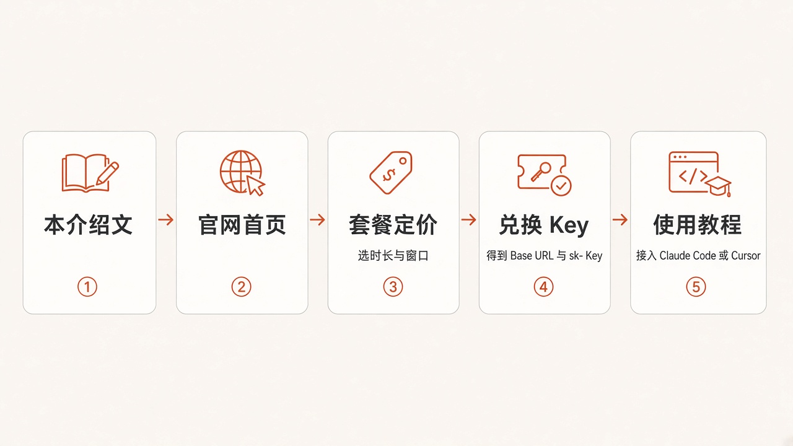

# Claude 无限卡是什么：订阅期内不按 token 计费

> 正式发布地址：[claude-unlimited.aiautotools.com/knowledge/what-is-claude-unlimited](https://claude-unlimited.aiautotools.com/knowledge/what-is-claude-unlimited) ｜ 源码与文档：[GitHub 仓库](https://github.com/autotoolai/claude-unlimited)

> **一句话答案**：Claude 无限卡是独立运营的第三方 API 网关——订阅期内调用 Claude 不按 token 计费。它与 Anthropic 官方无隶属关系；接入时只改 Base URL 与 API Key。文档与介绍在 `claude-unlimited.aiautotools.com`；官方管理后台与 API 网关是 `rsxermu666.cn`，二者同一运营方。

截至 2026-11-05，本文口径与站点首页、[套餐定价](/pricing)、[常见问题](/faq)、[管理后台说明](/console)一致。在售档位与价格以定价页为准，本文不把价格写死。

## Claude 无限卡是什么

**结论**：它提供的是一段有效期内的固定价调用通道，不是官方账号，也不是「按百万 token 预充值」。

| 维度 | 说明 |
|---|---|
| 产品形态 | 第三方 API 网关：请求经兼容接口转发到上游模型 |
| 计费方式 | 订阅期内不按 token 出账；按时长与同时可开的会话窗口分档 |
| 接入方式 | 在管理后台兑换后得到 Base URL 与 `sk-` 开头的 Key，填进现有客户端 |
| 与官方关系 | 与 Anthropic 无隶属、授权或合作；Claude、Anthropic 等名称归各自所有者 |

三种常见形态可以这样记：

- **官方按量 API**：用多少算多少；
- **官方 Pro / Max 等订阅**：消费级产品附带额度，聊天与 Claude Code 常共用；
- **Claude 无限卡**：周期内固定价、不按 token 计费的网关通道。

搜「opus 无限卡」「fable 无限卡」时，通常指的就是本卡这类用法：一份订阅覆盖承诺档位，**不必另买 Opus 卡或 Fable 卡**；档位与价格见[套餐定价](/pricing)，model ID 见[模型广场](/models)。

token 账单怎么构成，见[Claude API 怎么计费：token 构成与估算](/knowledge/claude-api-pricing-explained)。

## 两个域名分别干什么

**结论**：`claude-unlimited.aiautotools.com` 是文档与介绍站；`rsxermu666.cn` 是官方管理后台与 API 网关。搜到其中一个时，用另一个核对是否同一产品，可避免认错站。

| 域名 | 角色 | 你在上面做什么 |
|---|---|---|
| `claude-unlimited.aiautotools.com` | 文档站 / 官网介绍 | 看产品说明、定价口径、使用教程、知识库、FAQ |
| `https://rsxermu666.cn/` | 管理后台 / API 网关 | 粘贴卡密兑换 Key、查看面板、把 Base URL 与 Key 接到客户端 |

文档站上的[管理后台说明](/console)介绍后台能做什么；**兑换与日常操作在 `rsxermu666.cn` 完成**。二者同属 Claude 无限卡运营方，不是两套互不相关的服务。

若搜索引擎里先跳出第三方「中转站检测」页，请回到本文或文档站核对：域名是否为 `rsxermu666.cn`、文案是否写明它是 Claude 无限卡的管理后台与网关。

## 「无限」取消什么、不取消什么

**结论**：取消的是账单里的 token 计量；不取消有效期、会话窗口与公平使用边界。把「不按 token 计费」理解成「没有任何限制」，或理解成「其实还是按量」，都不准确。

**取消的是**

- 订阅期内，单次调用消耗多少 token，都不单独加价；
- 同一订阅价内可选本卡承诺档位的模型，不因选更高档模型再付按量差价（档位内模型见[模型广场](/models)）；
- 不必一边跑长会话一边盯按量仪表盘。

**不取消的是**

- 套餐有效期（天 / 周 / 月等，以[套餐定价](/pricing)为准）；
- 档位差别主要在「同时能开几个会话窗口」，不是「token 池有多大」；
- 仍可能遇到速率类限制（例如 429）——这是公平使用与容量保护，不是按 token 扣费，见[Claude Code 报 429 限流怎么办](/knowledge/claude-code-429-rate-limit)；
- 不包含生产环境多用户流量、超范围压测、二次转卖，也不包含 claude.ai 网页版等官方产品订阅权益。

## 和官方按量、官方订阅怎么选

**结论**：先问自己「每次开长任务前要不要心算这次大概多少 token」，再选形态。没有绝对更便宜的那一种，只有更匹配工作方式的那一种。

| 方式 | 本质 | 更适合 | 不太适合 |
|---|---|---|---|
| 官方 Pro / Max 等 | 消费级产品 + 共享额度 | 主要在官方产品里聊天，偶尔用 Claude Code | 每天长会话、多 Agent、反复撞用量上限 |
| 官方按量 API | 用多少算多少 | 调用少、规模可预测、要精确控单次成本 | 每天大仓库重构、多步 Agent |
| Claude 无限卡 | 周期固定价、不按 token 计费 | 每天在 Claude Code / Cursor 里写代码、长上下文、多步 Agent | 用量极小；要企业 SLA / 合同发票；必须每条请求直连官方 |

官方订阅撞上限时的分流，见[Claude 提示用量上限：分清是哪个计量器](/knowledge/claude-code-usage-limit-reached)。

## 适合谁，不适合谁

**结论**：高频、长会话、要可预期账单的人更匹配；低频小调用、强合规合同需求的人不匹配。写清楚「不适合」，是为了少踩预期差，不是制造紧迫感。

**更匹配**

- 每天在 Claude Code / Cursor 里改代码，按量账单会随上下文失控；
- 希望在同一订阅价内使用更高档模型，不愿再付按量溢价；
- 需要在多个兼容客户端之间切换，只想配一次全局生效。

**不匹配**

- 一周只调用几次、每次规模很小——按量往往更省；
- 需要企业级 SLA、合同与发票流程——本站是个人开发者运营的网关服务，边界见[关于页面](/about)；
- 要求每一条请求都必须直连 Anthropic 官方、不经任何中间层。

## 文档与接入入口在哪

**结论**：介绍文只负责讲清「是什么」；档位口径、兑换与分客户端步骤以站点文档与管理后台为准。下面是文档地图，不是促销清单——删掉链接后，上文的定义与边界仍然成立。



| 你想核对什么 | 看哪一页 | 这一页解决什么 |
|---|---|---|
| 品牌与文档域名是否对得上 | [站点首页](/) | 确认文档站为 `claude-unlimited.aiautotools.com` |
| 时长、窗口档位与现行价格 | [套餐定价](/pricing) | 以该页与商品详情为最终准价，避免转载文写死过期价格 |
| 卡密如何换成 Base URL 与 Key | [管理后台](https://rsxermu666.cn/)（说明见[/console](/console)） | 在 `rsxermu666.cn` 粘贴卡密，得到接入所需的两个值 |
| 各客户端怎么填 | [使用教程](/guide) | 按 Claude Code / 桌面版 / Cursor 等分路径，带截图 |
| 规则与售后口径 | [常见问题](/faq) | 窗口、不包含项、退款摘要等 |

已经拿到 Key、只差配置时，优先打开[使用教程](/guide)；Claude Code 可从[插件路径](/guide/cc)或[CLI 路径](/guide/cli)入手。

## 接入只需改两处配置

**结论**：不必重写业务逻辑；兼容 Anthropic 接口的客户端，通常只改 Base URL 与 API Key。

1. 按[套餐定价](/pricing)选定档位并完成支付后，会收到卡密；
2. 打开管理后台 [https://rsxermu666.cn/](https://rsxermu666.cn/)，粘贴卡密，页面给出 Base URL 与 `sk-` 开头的 Key（后台能力说明见[/console](/console)）；
3. 写入客户端或环境变量：

```bash
export ANTHROPIC_BASE_URL="https://<兑换页给出的 Base URL>"
export ANTHROPIC_API_KEY="sk-..."
```

兑换页给出的 Base URL 即控制台侧网关地址（域名属于 `rsxermu666.cn` 这一套）。分客户端截图与差异以[使用教程索引](/guide)为准；本文不重复逐步截图，避免与教程页两套口径。

## 信任边界：先看清再决定

**结论**：第三方网关有明确边界。下列事实比任何促销语都优先。

- **不是官方**：不提供 Anthropic 官方账号，也不出售官方网页版 / 桌面版订阅权益。
- **请求内容**：以提供服务与排障所必需为限记录用量元数据（时间、模型、状态、消耗、请求标识）；不记录 prompt 正文与模型输出。细则见站点隐私说明。
- **稳定性**：网关用多上游路由与故障转移提升可用；服务仍依赖上游与公网，不对「绝不中断」作绝对保证。
- **售后与规则**：退款、窗口、不包含项以[套餐定价](/pricing)与商品详情为准；本仓库 issue 只处理文档与源码问题，不是客服工单。

若你仍在比较计费形态，继续读[Claude API 怎么计费：token 构成与估算](/knowledge/claude-api-pricing-explained)。若定义与边界已经够用，请同时核对两个域名：文档站 `claude-unlimited.aiautotools.com`，管理后台与网关 `rsxermu666.cn`；站外也可搜索「Claude 无限卡」「rsxermu666.cn」交叉确认。
